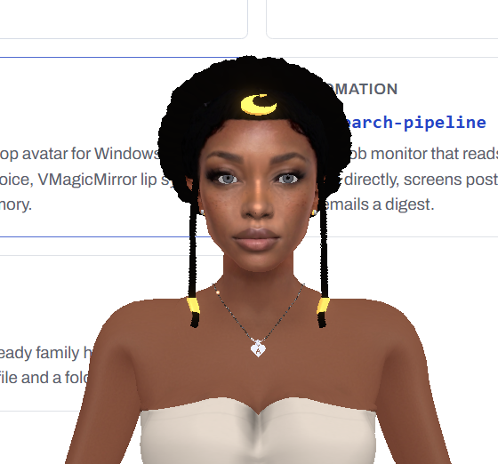

# Project AION: a talking desktop avatar for Windows

Project AION puts an animated 3D character on your Windows desktop that listens through your microphone, answers out loud through OpenAI's Live API, and moves her lips in time with her voice.

The character runs in [VMagicMirror](https://malaybaku.github.io/VMagicMirror/en/), a free app that displays a VRM avatar in a transparent window. A Python script (`scriptspy/Aurora.py`) holds the voice conversation and sends the assistant's audio to two places: your headphones, so you hear her, and a virtual audio cable that VMagicMirror listens to for lip sync. She greets you by time of day, reads your Google Calendar, adds and edits events by voice, keeps a plain-text memory file, and switches between modes such as lecture and tech support.

It exists because a voice assistant is easier to talk to when it has a face, and because the pieces to build one (free avatar tools, a realtime voice API, a virtual audio cable) are all available to an individual. This repo is the working setup plus a guide to building your own character from scratch.

## Contents

- [Demo](#demo)
- [How it works](#how-it-works)
- [Hardware required](#hardware-required)
- [Software required](#software-required)
- [Installation](#installation)
- [Configuration](#configuration)
- [Usage](#usage)
- [Project layout](#project-layout)
- [Build your own avatar](docs/build-your-avatar.md)
- [Voice model options and cost](docs/voice-options.md)
- [Calendar, projects, home automation, and choosing a role](docs/integrations.md)
- [Credits](#credits)
- [Modifications by Dr. Reginald Finley](#modifications-by-dr-reginald-finley)
- [License](#license)
- [Contact](#contact)

## Demo

[](https://youtu.be/dExOrEA55wY)

[Watch Aion speak on YouTube](https://youtu.be/dExOrEA55wY). Click the picture or the link; the avatar listens, answers out loud, and lip-syncs in VMagicMirror.

## How it works

```
 microphone ──► Aurora.py ──► OpenAI Live API (speech in, speech out)
                    │
                    ├──► headphones / speakers  (you hear her)
                    └──► VB-CABLE "CABLE Input" ──► VMagicMirror lip sync ──► avatar on your desktop
```

VMagicMirror animates the avatar's mouth from whatever audio arrives on its lip-sync input. VB-CABLE is a virtual audio device: audio played into "CABLE Input" comes out of "CABLE Output", and VMagicMirror listens to "CABLE Output". Aurora.py plays the same audio to your real headphones at the same time.

## Hardware required

- A Windows 10 or 11 PC. The scripts use Windows audio APIs, `tasklist`, and `.bat` launchers.
- A microphone. A headset or USB microphone works better than a laptop's built-in mic, because the assistant hears her own voice less.
- Headphones or speakers. Headphones reduce echo; with speakers she may hear herself and stop talking.
- A graphics card that runs VMagicMirror smoothly. Most PCs from the last several years with a dedicated or recent integrated GPU are fine.

## Software required

| Software | Version | Notes |
| --- | --- | --- |
| Python | 3.12 (tested on 3.12.2) | https://www.python.org/downloads/ . Tick "Add python.exe to PATH" during install. |
| Python packages | see `requirements.txt` | Pinned to the versions Aion runs on. |
| VMagicMirror | current release | https://malaybaku.github.io/VMagicMirror/en/ (download link on that page). |
| VB-CABLE | current release | https://vb-audio.com/Cable/ . Donationware. Reboot after installing. |
| An OpenAI API key | | https://platform.openai.com/api-keys . The key's project needs access to the Live API model (paid usage). |
| A VRM avatar | VRM 0.x or 1.0 | Make one or download one. See [docs/build-your-avatar.md](docs/build-your-avatar.md). |
| Vosk small English model | 0.15 | Only for the optional wake word. See `models/README.md`. |

## Installation

All commands run in PowerShell from the project folder.

1. Download this repository (green "Code" button, then "Download ZIP") and unzip it, or clone it with Git.

2. Create a virtual environment and install the packages. The folder name `myenv` matters, because the launch scripts look for it.

   ```powershell
   py -3.12 -m venv myenv
   .\myenv\Scripts\Activate
   pip install -r requirements.txt
   ```

   If PowerShell refuses to run `Activate`, run `Set-ExecutionPolicy -Scope CurrentUser RemoteSigned` once and try again.

3. Install VB-CABLE from https://vb-audio.com/Cable/ (run the installer as administrator) and reboot. Afterwards, Windows Sound settings should list "CABLE Input (VB-Audio Virtual Cable)" under playback devices.

4. Install VMagicMirror and open it. Load your `.vrm` file. In VMagicMirror's settings:
   - Set the lip sync microphone to **CABLE Output (VB-Audio Virtual Cable)**.
   - Turn on the transparent background so only the character shows on your desktop, then drag her where you want her.
   - The exact menu names change between versions; the [VMagicMirror manual](https://malaybaku.github.io/VMagicMirror/en/) shows the current ones.

5. Copy `.env.example` to `.env` and put your OpenAI API key in it (see [Configuration](#configuration)).

6. Test from a console:

   ```powershell
   .\scripts\run_console.bat
   ```

   The script prints every audio device with an index number, then `[aion] session started`, then her greeting. Speak, and you should see `[you]` and `[aion]` lines and see the avatar's mouth move. If the mouth does not move, recheck step 4. If you hear nothing, set `AURORA_OUT_MON` to your headphones' index from the printed list.

7. Optional: build a standalone `Aurora.exe` so you can start Aion without a console.

   ```powershell
   .\myenv\Scripts\pyinstaller.exe Aurora.spec --clean --noconfirm
   ```

   The exe lands in `dist\`. It reads `.env` from the project folder (one level above `dist\`) and writes its output to `logs\aurora_stdout.log` and `logs\aurora_stderr.log`.

## Configuration

All settings live in `.env` (copied from [`.env.example`](.env.example), which explains each value). Any setting can also be a Windows environment variable (`setx NAME value`), which takes precedence over `.env`.

The settings most people change:

| Setting | What it does |
| --- | --- |
| `OPENAI_API_KEY` | Required. Your key. Alternatively, put it alone in `keys/openai.key`. |
| `AION_USER_NAME` | What she calls you. Leave empty and she asks. |
| `AURORA_VOICE` | One of the Live API voices, for example `gleam`, `delta`, or `marin`. |
| `AURORA_MODE` | Starting mode: `default`, `lecture`, `grading`, `job_search`, `tech_support`. |
| `AURORA_IN_DEV`, `AURORA_OUT_VB`, `AURORA_OUT_MON` | Device index numbers for mic, VB-CABLE, and headphones, if auto-selection picks the wrong ones. |
| `AURORA_NO_CALENDAR` | `1` turns off Google Calendar. Setup steps are in [docs/integrations.md](docs/integrations.md). |
| `VMAGICMIRROR_EXE` | Full path to `VMagicMirror.exe`, so `start_aion.bat` can open it for you. |

Two files personalize her, and both are gitignored so your details stay on your machine:

- `config/profile.md` (copy from `config/profile.example.md`): who you are and how you like answers.
- `memory/aion_memory.md` (copy from `memory/aion_memory.example.md`): notes she reads at every launch. Saying "Aion, remember that my dentist is on Fridays" appends a dated line to it.

Her personality, safety rules, and modes are in `CORE_INSTRUCTIONS` and `MODE_PRESETS` near the middle of `scriptspy/Aurora.py`. Edit those to change who she is.

## Usage

Start: double-click `scripts\start_aion.bat`. It opens VMagicMirror if `VMAGICMIRROR_EXE` is set, waits 8 seconds for the avatar to load, then starts Aion. To start her at login, put a shortcut to `start_aion.bat` in the Startup folder (press Win+R, type `shell:startup`).

Stop: say "Thank you Aion, that is all for now", or double-click `scripts\stop_aion.bat`. VMagicMirror stays open.

Things to say:

| You say | What happens |
| --- | --- |
| "What's on my calendar tomorrow?" | She answers from the calendar she read at launch. |
| "Add lunch with Sam on Friday at noon to my calendar." | The script creates the event and she confirms it. |
| "Move that to 1 PM." / "Undo that." | Edits or reverses the last add or edit. |
| "Remember that my sister's birthday is June 3." | Appends the note to `memory/aion_memory.md`. |
| "Set mode lecture." / "List modes." | Switches or lists modes. |
| "Thank you Aion, that is all for now." | She says goodbye and the session closes. |

You can talk over her; she stops and listens.

Optional wake word: `scriptspy/WakeWatcher.py` listens offline (with Vosk) for "hello aion" and starts Aion. Download the model first (see `models/README.md`), then run `.\myenv\Scripts\python.exe scriptspy\WakeWatcher.py`. Set `AURORA_WAKE_DEBUG=1` to log every phrase Vosk hears, which helps when it does not recognize the word "aion".

## Project layout

```
project-aion/
├── scriptspy/
│   ├── Aurora.py          voice client: audio devices, Live API session, calendar, memory, modes
│   └── WakeWatcher.py     optional offline wake word that launches Aion
├── scripts/
│   ├── start_aion.bat     opens VMagicMirror, then Aion
│   ├── stop_aion.bat      stops Aion, leaves VMagicMirror running
│   └── run_console.bat    runs from source with a visible console, for testing
├── config/profile.example.md
├── memory/aion_memory.example.md
├── keys/README.md         where optional key files go (gitignored)
├── models/README.md       where the Vosk model goes (gitignored)
├── docs/                  avatar guide, voice options, integrations
├── media/                 demo screenshots and clips
├── Aurora.spec            PyInstaller build file for Aurora.exe
├── .env.example           every setting, with placeholders
├── requirements.txt
└── LICENSE
```

## Credits

Project AION runs alongside and depends on the following work. None of their code is copied into this repository; each is installed separately under its own license.

| Project | Author | Link | License |
| --- | --- | --- | --- |
| VMagicMirror | Baku (malaybaku) | https://github.com/malaybaku/VMagicMirror | MIT |
| VB-CABLE Virtual Audio Device | VB-Audio Software | https://vb-audio.com/Cable/ | Donationware, see site |
| OpenAI Live API (gpt-live-1) and Responses API | OpenAI | https://platform.openai.com/docs | OpenAI terms of use |
| Vosk speech recognition and models | Alpha Cephei | https://github.com/alphacep/vosk-api | Apache 2.0 |
| python-sounddevice | Matthias Geier | https://github.com/spatialaudio/python-sounddevice | MIT |
| PortAudio (used by sounddevice) | PortAudio contributors | https://www.portaudio.com/ | MIT-style |
| websockets | Aymeric Augustin and contributors | https://github.com/python-websockets/websockets | BSD 3-Clause |
| NumPy | NumPy developers | https://github.com/numpy/numpy | BSD 3-Clause |
| Requests | Kenneth Reitz and contributors (Python Software Foundation) | https://github.com/psf/requests | Apache 2.0 |
| google-auth, google-auth-oauthlib | Google LLC | https://github.com/googleapis/google-auth-library-python | Apache 2.0 |
| PyInstaller | PyInstaller Development Team | https://github.com/pyinstaller/pyinstaller | GPL 2.0 with bootloader exception |
| Google Calendar API | Google LLC | https://developers.google.com/calendar | Google APIs terms of service |

The VRM format is maintained by the [VRM Consortium](https://vrm.dev/en/). Tools mentioned in the avatar guide are credited there.

Development was done with help from AI coding assistants (Claude by Anthropic, and ChatGPT by OpenAI).

The avatar models Dr. Finley uses with Aion are not included. Each VRM file carries its own license from its creator in its metadata, and avatars you find or buy should be used only as their license allows.

## Modifications by Dr. Reginald Finley

Dr. Finley designed and built this integration, working with the AI coding assistants noted above. The upstream projects are used as published. His work in this repository:

- **Voice client (`Aurora.py`).** Connects a microphone to the OpenAI Live API over a websocket, streams the assistant's audio to two output devices at once (a virtual cable for lip sync and headphones for listening), and resamples audio between 24 kHz and whatever rate each device accepts.
- **Audio device handling.** Ranks Windows host APIs (MME, then DirectSound, then WASAPI), skips WDM-KS, matches devices by name keywords, and falls back to the Windows default output. Playback is callback driven with a shared buffer so the network loop never blocks, and when the connection stalls the microphone queue drops the oldest audio and keeps running.
- **Persona and modes.** Aion's instructions, five switchable modes, a time-of-day greeting that she composes herself, and a spoken end phrase that closes the session.
- **Voice commands handled in code.** Regex-based intent detection on the live transcript for "remember that ...", calendar add, edit, and undo, and mode switching, with the result spoken back through the session.
- **Google Calendar by voice.** Reads upcoming events at launch, turns spoken requests into events with a small text model and a strict JSON schema, copies the color of earlier events with the same title, and supports multi-turn follow-up when a detail is missing.
- **Long-term memory.** A plain Markdown file that she reads at launch and appends to by voice.
- **Reliability.** Automatic reconnect with backoff, file logging with size limits when running without a console, and a standalone exe build.
- **Wake word (`WakeWatcher.py`).** Offline wake-phrase detection with Vosk that launches Aion.
- **Launchers.** Batch files that start VMagicMirror first, then Aion, and stop Aion without closing the avatar.
- **For this public release:** personal details, machine paths, and device names were replaced with settings in `.env` and the gitignored profile and memory files; a `.env` loader was added; the wake word now launches Aion; and the guides in `docs/` were written.

## License

The code in this repository is released under the [MIT License](LICENSE), copyright Reginald Finley. Third-party software listed under Credits keeps its own license.

## Contact

contact@drreginaldfinley.com
